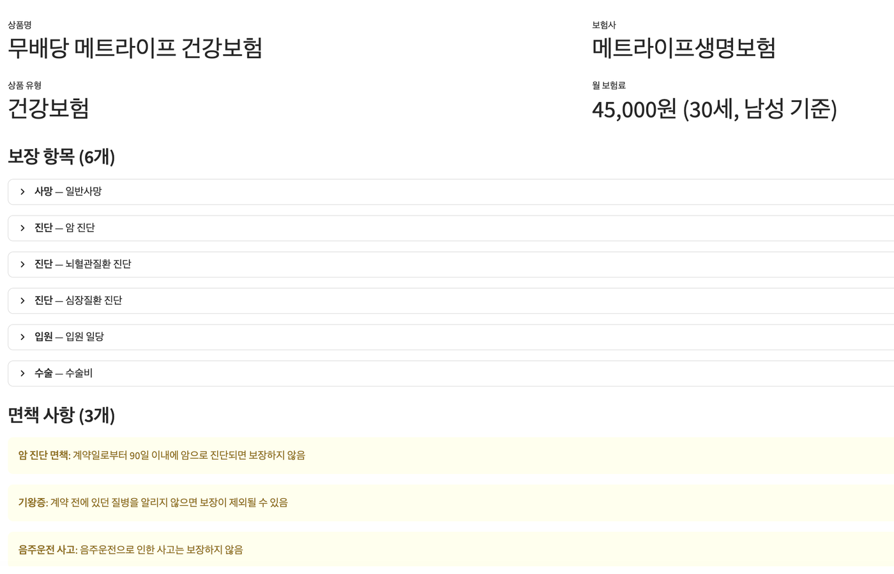
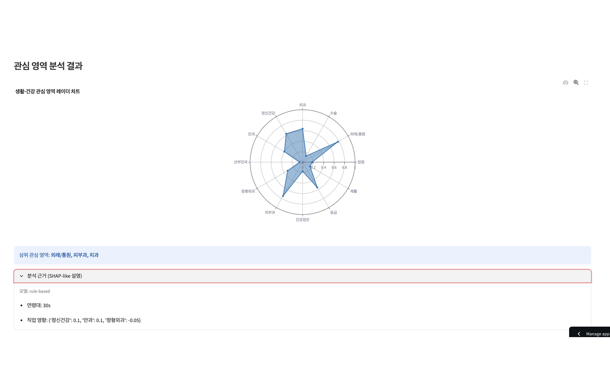
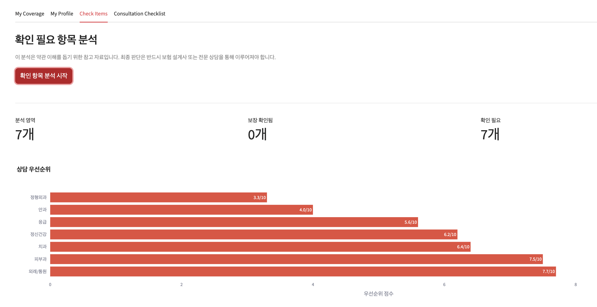
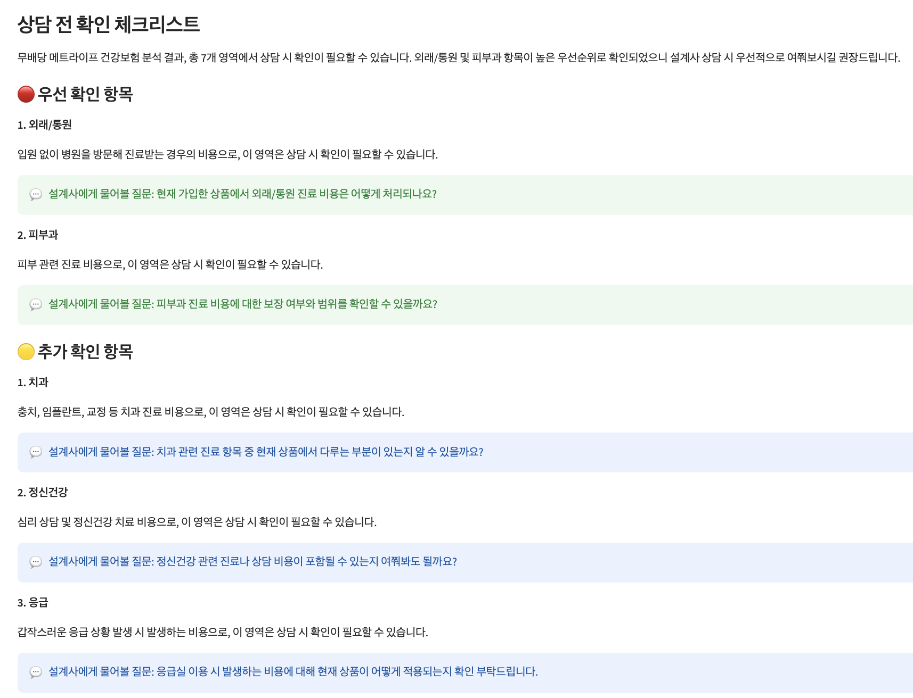

# Coverage Checklist Assistant

> 보험 약관 이해 보조 + 상담 시 확인 필요 영역 탐지 + 상담 전 체크리스트 생성 AI Assistant 프로토타입

Python · LangGraph · Anthropic Claude API · XGBoost · ChromaDB · Streamlit

[](https://coverage-checklist-assistant.streamlit.app/)

---

## 1. 프로젝트 개요

**출발 질문:** "고객이 상담 전에 자신의 보장 상태를 미리 이해하고, 설계사에게 물어볼 질문을 준비할 수 있다면?"

보험 약관은 수십 페이지의 법률 문서로, 대부분의 고객은 자신의 보장 범위를 정확히 이해하지 못한다. 이 프로젝트는 고객(또는 설계사)이 보험 상품 요약서를 입력하면, AI가 보장 항목을 일상 언어로 변환하고, 생활·건강 관심 영역과 대조하여 상담 시 확인이 필요한 영역 후보를 탐지한 뒤, 상담 전 체크리스트를 자동 생성하는 사전 점검 도구의 프로토타입을 구축한다.

**경계:** 보험 상품 추천이나 가입 권유 도구가 아니다. 약관 이해를 돕고, 설계사 상담 전 확인 항목을 안내하는 사전 점검 보조 도구이다. 최종 판단은 반드시 설계사/전문 상담을 통해 이루어져야 한다.

---

## 2. 산업 맥락 & 포지셔닝

### 2.1 손해보험사 AI 활용 현황 (KB손해보험 사례)

| 시점 | 내용 |
|---|---|
| 2025.03 | DT추진본부 산하 **AI데이터분석파트** 신설 — 상품기획·지급심사·고객 맞춤 서비스에 AI 분석/모델링 적용 |
| 2025.04 | 그룹 공동 **KB GenAI 포털** 구축 — 상용/오픈소스 LLM + RAG 기반 내부 문서 검색 + 에이전트 개발·시험 환경 통합 |
| 2025.09~ | **자동차사고 과실비율 AI Agent**, AI 민원 해결 도우미, 콜센터 상담지원 AI Agent 순차 도입 — 발굴 과제 45개 중 22개 개발 완료 |
| 계획 | 설계사 대상 **고객 맞춤형 보장 분석 + 부족 보장항목 보완 추천** 기능, 다이렉트 자동차 AI 챗봇 |

KB손보는 "현업 부서가 보험 전문지식과 개선 과제를 제시하면 AI 전담조직이 기술 개발을 지원하는" 협업 체계를 운영하며, 내부 업무(보상·인수·민원)에서 축적한 AI를 고객 서비스로 확장하는 단계다.

### 2.2 공백과 포지셔닝

| 기존 접근 | 형태 | 한계 |
|---|---|---|
| KB GenAI 기반 내부 에이전트 (과실비율·민원·상담지원) | 임직원 업무지원 | 고객은 상담 **이후** 결과만 받음 |
| 설계사용 보장분석·보완 **추천** (KB손보 계획, 삼성화재·신한라이프 운영) | 설계사 영업지원 | AI 추천을 설계사가 검증 없이 쓰면 **불완전판매** 위험이 지적됨 |
| 기존 보장분석 서비스 (설계사 수동 점검) | 대면 | 설계사 의존, 확장 불가 |

이 프로젝트는 **상담 이전** 단계를 겨냥한다. 고객이 자신의 상품요약서를 넣으면 보장을 일상 언어로 풀어 주고, 공공 의료이용 통계 기반 관심 영역과 대조해 "설계사에게 확인할 질문"을 만들어 준다. **추천·권유는 하지 않는다** — 권유 표현은 프롬프트와 후처리 필터 두 겹으로 차단한다. 업계가 우려하는 "AI 추천 → 불완전판매" 경로를 설계 단계에서 끊고, 상담 생산성(설계사 반복 설명 감소)과 고객 이해도를 동시에 올리는 PoC다.

---

## 3. 파이프라인 아키텍처

```
[사용자 입력]
├── 보험 상품 요약서 (KB손해보험 상품요약서 PDF or 텍스트 붙여넣기)
└── 생활 프로파일 (연령, 직업군, 가족 구성, 건강 관심사)
        │
        ▼
┌─ Node 1: Coverage Parser ────────────────────────────
│  상품 요약서 PDF → 섹션 추출 → 구조화 JSON
│  보장 항목 / 면책 / 한도 / 대기기간
│  → 일상 언어 변환 + 원문 출처 표시
│  Model: Claude Haiku (경량 LLM)
│  Data: KB손해보험 상품요약서 7종 (공시실, 손보협회 표준 양식)
└──────────────────────────────────────────────────────
        │
        ▼
┌─ Node 2: Health & Lifestyle Profiler ────────────────
│  프로파일 기반 관심 영역 벡터 생성
│  "30대 사무직 → 치과/외래·통원/피부과 상위"
│  Data: 건보심평원 상병 진료통계 27.7만 건 (baseline)
│        건보공단 건강검진정보 100만 명 (XGBoost)
│  Model: XGBoost (12-category multi-output)
└──────────────────────────────────────────────────────
        │
        ▼
┌─ Node 3: Gap Detector ──────────────────────────────
│  보장 범위 vs 관심 영역 대조
│  → 상담 시 확인할 영역 후보 + 우선순위
│  "통원 치료: 보장 미포함 — 상담 우선순위 8/10"
│  Model: Rule-based + ML hybrid
└──────────────────────────────────────────────────────
        │
        ▼
┌─ Node 4: Checklist Generator ────────────────────────
│  확인 항목을 상담 전 체크리스트로 변환
│  "상담 시 확인할 항목:"
│  1. 통원 보장이 포함되어 있지 않습니다...
│  2. 치과 보장 한도가 평균 대비 낮을 수 있습니다...
│  Model: Claude Sonnet (고성능 LLM)
└──────────────────────────────────────────────────────
        │
        ▼
┌─ Guardrail ─────────────────────────────────────────
│  "최종 판단은 설계사 상담 필요" 고정 삽입
│  RAG fallback: "자동 분석 범위 밖"
│  권유 표현 후처리 필터링 (regex + blocklist)
└──────────────────────────────────────────────────────

┌─ ChromaDB RAG ──────────────────────────────────────
│  KB손해보험 상품요약서 7종 → 섹션 단위 chunk 임베딩
│  상품별 보장 상세, 면책사항 검색 지원
└──────────────────────────────────────────────────────
```

### 비용 거버넌스: Node별 모델 티어 분리

| Node | 모델 선택 | 근거 | 비용 |
|---|---|---|---|
| Node 1 (Parser) | Claude Haiku | 구조화 태스크, 비용 1/10 | ~$0.0096/건 |
| Node 2 (프로파일) | XGBoost | LLM 불필요 | $0 |
| Node 3 (탐지) | Rule-based + ML | LLM 불필요 | $0 |
| Node 4 (체크리스트) | Claude Sonnet | 고객 대면 텍스트, 품질 중요 | ~$0.0360/건 |
| **합계** | | | **$0.0456/건** |

전수 Sonnet 대비 **68% 비용 절감** ($0.1440 → $0.0456/건).

---

## 4. 데이터 & 모델

### 4.1 데이터 소스 (100% 한국 공공데이터)

| 데이터 | 소스 | 규모 | 용도 |
|---|---|---|---|
| KB손해보험 상품요약서 | kbinsure.co.kr 공시실 > 상품목록(약관) | 7종 PDF (3~207p) | Node 1 파싱 대상 + RAG 임베딩 |
| HIRA 상병별 진료 통계 | data.go.kr (건보심평원) | 277,046 rows | Node 2 baseline lookup |
| NHIS 건강검진정보 | data.go.kr (건보공단) | 1,000,000명 | Node 2 XGBoost 학습 |

### 4.2 XGBoost 모델 성능

- 학습 데이터: NHIS 건강검진정보 2024 (100만 명, 17 features)
- Train/Test split: 80만 / 20만
- 12-category multi-output regression
- MSE: 0.0007 ~ 0.0009 (전 카테고리)

| Feature | 설명 | 중요도 (입원 카테고리) |
|---|---|---|
| age_code | 5세 단위 연령대 | 0.966 |
| has_children | 자녀 유무 | 0.025 |
| bmi | 체질량지수 | - |
| sbp / dbp | 수축기/이완기 혈압 | - |
| fasting_glucose | 공복혈당 | - |
| smoking / drinking | 흡연/음주 상태 | - |

### 4.3 PDF 파싱 성능

KB손해보험 상품요약서 7종 (상해·질병·치아·운전자) 대상:

| 상품코드 | 상품 | 요약서 분량 | 섹션 탐지 | LLM 파싱 (Haiku) |
|---|---|---|---|---|
| 25477 | KB손보 실손의료비보장보험(무배당)(26.09) | 10p | 4/4 | high · 10 items (입원·통원·치료) |
| 25438 | KB 5.10.10 플러스 건강보험(세만기)(무배당)(26.09) | 144p | 4/4 | high · 10 items (진단·후유장해·수술·입원·사망) |
| 25342 | KB The건강한치아보험(무배당)(26.07) | 16p | 4/4 | high · 10 items (치과) |
| 25290 | KB 9회주는 암보험Plus(무배당)(26.07) | 118p | 4/4 | medium · 10 items (진단·납입면제·질병·상해) |
| 25275 | KB 금쪽같은 희망플러스 건강보험(무배당)(26.07) | 195p | 4/4 | medium · 10 items |
| 25282 | KB 금쪽같은 자녀보험Plus(무배당)(26.07) | 207p | 4/4 | medium · 10 items |
| 15506 | KB스마트운전자보험 (일반보험) | 3p | 4/4 | medium · 6 items (벌금·처리지원금·상해) |

| 지표 | KB손보 7종 (손보 양식) | 참고: 생보사 요약서 42종 (초기 검증) |
|---|---|---|
| 섹션 탐지율 | **28/28 (100%)** | 155/168 (92%) |
| 상품명 자동 추출 | 7/7 | 42/42 |
| LLM 파싱 성공률 | **7/7 (100%)** | 42/42 (100%) |
| confidence high | **3/7 (43%)** | 5/42 (12%) |
| confidence medium 이상 | 7/7 (100%) | 41/42 (97.6%) |

손보협회 상품통일 공시기준 양식(가. 특이사항 / 나. 보험금 지급사유·지급금액·지급제한 / 다. 보험료 산출기초)이 생보 양식보다 정형적이라, 초기 검증에 쓴 생보사 요약서 42종의 92%보다 높은 탐지율이 나왔다. 특히 `보장명 | 지급사유 | 지급금액` 3열 표가 그대로 추출돼 Node 1 입력 품질이 좋다.

### 4.4 ChromaDB RAG

- KB 7종 PDF → 섹션(가입자격/특이사항/보장내용/면책) 단위 500자 chunk, overlap 50 → **1,017 chunks**
- 임베딩: `paraphrase-multilingual-MiniLM-L12-v2` (한국어 가능, 118M) — Chroma 기본 `all-MiniLM-L6-v2`는 영어 전용이라 한국어 쿼리가 임계값을 넘지 못했음
- 유사도: cosine, 비필터 검색 threshold 0.45; 상품·섹션 필터 검색은 필터가 이미 범위를 좁히므로 임계값 미적용
- 가입자격 섹션은 담보별 가입나이 표가 수십만 자라 6,000자로 캡 (검색 결과를 뒤덮는 것 방지)

| 쿼리 | 상위 결과 | score |
|---|---|---|
| 암 진단 보험금 지급 | 희망플러스 건강보험·9회주는 암보험 **보장내용** (암 주요치료, 유사암 50%) | 0.81 |
| 입원비 통원비 수술비 | 5.10.10 건강보험 보장내용 (상해수술비·종합병원) | 0.72 |
| 실손의료비 보장내용 (상품 필터) | 실손 기본계약 `보장명/지급사유/지급금액` 첫 청크 | 0.78 |
| 치아 임플란트 보철 치료비 | 약함 (0.59, 오매칭) — 소형 모델 + 표 레이아웃 텍스트의 한계 |

---

## 5. 개발 여정 & 문제 해결

### 5.1 Phase 1: 스켈레톤 -> MVP (Day 1)

4-Node 파이프라인 스켈레톤을 먼저 구축하고, 각 Node를 순차적으로 테스트했다.

**마주한 문제: Streamlit에서 LLM API 호출 실패**

테스트 스크립트(`python scripts/test_node1_parser.py`)에서는 Haiku 파싱이 정상 동작했으나, Streamlit 대시보드에서는 모든 파싱이 실패 (confidence: low, items: 0). 원인은 `app.py`에서 `.env` 파일을 로드하지 않아 `ANTHROPIC_API_KEY`가 없었던 것.

```python
# 수정: app.py 최상단에 dotenv 로드 추가
from dotenv import load_dotenv
load_dotenv()
```

**마주한 문제: Sonnet 모델 ID 404 에러**

`claude-sonnet-4-20250514`가 deprecation 예정 모델이라 404 반환. `claude-sonnet-4-6`으로 교체하여 해결. 이 경험으로 LLM 백엔드 추상화의 가치를 실감 — 환경변수 하나로 모델 교체가 가능한 구조였기에 수정이 간단했다.

### 5.2 Phase 2: Node 2 고도화 - Synthetic에서 실제 데이터로

**초기 접근: Synthetic 데이터 + Kaggle Prudential**

처음에는 HIRA 통계 패턴을 보고 합성 데이터를 만들어 XGBoost를 학습시켰고, Kaggle Prudential Life Insurance 데이터(59,381건)를 보조 학습 데이터로 계획했다.

**전환 결정: Kaggle Prudential 제거**

Kaggle Prudential은 미국 보험 신청자 데이터(BMI, Ht, Wt 등)라서 한국 보험 시장과 맞지 않았다. 30대 한국 사무직의 의료이용 패턴을 미국 데이터로 학습하면 의미가 없다는 판단 하에 완전히 제거하고, 한국 공공데이터만 사용하기로 전략을 변경했다.

**실제 데이터 확보 및 적용:**

1. **건보심평원 상병별 진료 통계** (data.go.kr): KCD 4단 상병코드 × 성별 × 5세 연령군 → 환자수. 277,046 rows, 12,132개 질병코드를 12개 관심 영역에 매핑하여 baseline lookup table을 교체했다.

2. **건보공단 건강검진정보** (data.go.kr): 100만 명 개인 수준 데이터 (성별, 연령대, 신장, 체중, 혈압, 혈당, 콜레스테롤, 간수치, 흡연, 음주). XGBoost 학습 데이터로 사용하여 Synthetic 데이터를 완전 교체했다.

**결과: Synthetic → Real 전환 효과**

| 항목 | Synthetic | Real |
|---|---|---|
| Baseline | 직접 작성한 가짜 수치 | HIRA 27.7만 건 집계 |
| XGBoost 학습 | 10K synthetic samples | 100만 명 건강검진 데이터 |
| 20대 Top 3 | 치과, 외래/통원, 정신건강 | 피부과, 외래/통원, 치과 |
| 60+ Top 3 | 외래/통원, 건강검진, 안과 | 입원, 재활, 정신건강 |
| 설명 가능성 | 임의로 만든 분포 | 한국 공공데이터 100만 명 기준 |

20대에서 피부과가 1위로 올라온 것, 60+에서 입원·재활이 상위로 올라온 것은 실제 한국 의료이용 패턴과 일치한다.

### 5.3 Phase 3: 실제 공시 PDF 파싱 (생보사 요약서로 초기 검증)

**마주한 문제: macOS에서 `pdftotext` 미설치**

초기 PDF 추출기가 `pdftotext` (poppler-utils)에 의존했으나, macOS에 기본 설치되어 있지 않았다. `pypdf` 라이브러리로 fallback하는 구조로 수정하여 추가 설치 없이 동작하도록 했다.

**마주한 문제: Haiku JSON 출력 깨짐 (6/6 전부 실패)**

실제 생보사 상품요약서 PDF에서 추출한 한국어 텍스트를 Haiku에 보냈을 때, 반환된 JSON이 전부 "Unterminated string" 에러로 파싱 실패했다. 한국어 텍스트의 특수문자(따옴표, 줄바꿈)가 JSON string을 깨뜨린 것이 원인이었다.

3가지 수정으로 해결:
1. **JSON repair 로직**: 깨진 괄호/따옴표 자동 복구 + partial extraction
2. **입력 텍스트 축소**: 8K → 4K chars (Haiku 출력 길이 제한)
3. **프롬프트 강화**: "문자열 80자 이내, coverage_items 최대 10개" 제한

결과: 0/6 → 6/6 파싱 성공. 이후 생보사 요약서 42종 전체 테스트에서 100% 성공률(섹션 탐지 92%) 달성.

**마주한 문제: 한국어 파일명 Unicode NFD/NFC 불일치**

macOS는 파일명을 NFD (decomposed) 형태로 저장하는데, Python 문자열 리터럴은 NFC (composed) 형태. `os.path.exists()`가 False를 반환하여 파일을 찾지 못하는 현상이 발생했다. `unicodedata.normalize("NFC", filename)`으로 정규화하여 해결.

### 5.4 Phase 4: SHAP 호환성

**마주한 문제: SHAP + XGBoost 버전 충돌**

`shap.TreeExplainer(model)`에서 "could not convert string to float" 에러가 12개 카테고리 전부에서 발생. 최신 xgboost와 shap 사이의 알려진 호환성 문제였다.

해결: SHAP explainer를 캐싱하는 대신, XGBoost의 `feature_importances_`를 직접 사용하여 예측 시점에 설명을 생성하도록 변경. 이 접근이 실제로 더 안정적이고, 모델 직렬화 문제도 없다.

---

### 5.5 Phase 5: 생명보험 → 손해보험 피벗 (KB손해보험)

**대상 변경:** 초기 검증에 쓴 생보사 상품요약서 42종에서 **KB손해보험 상품요약서 7종**으로 파싱 대상을 바꿨다. 파이프라인·모델·가드레일은 그대로 두고, 문서 양식에 의존하는 Node 1 추출기와 Node 3 담보 어휘만 손봤다.

**마주한 문제 1: 요약서 양식이 다르다**

생보 양식은 `상품의 특이사항 / 보험가입자격요건 / 보험금 지급사유 및 지급제한 / 면책사항`인데, 손보협회 표준 양식은 `가. 가입자격제한 등 특이사항 → 1) 가입자격 2) 특이사항 / 나. 보험금 지급사유, 지급금액 및 지급제한사항 → 1) 담보별 지급사유·금액 2) 지급제한` 구조다. 면책이 `나.`의 하위 항목이라 문서 전체에서 첫 매치를 찾으면 엉뚱한 곳에 걸렸다.

해결: 섹션별 정규식을 **보험사 양식별 대안 목록**으로 바꾸고, 면책은 반드시 보장내용 위치 **이후**에서만 탐색하도록 앵커를 걸었다. `다. 보험료 산출기초`를 하드 스톱으로 둬서 면책이 보험료·해약환급금 섹션을 삼키지 않게 했다. 결과: 섹션 탐지 92% → **100%**.

**마주한 문제 2: pypdf가 KB PDF의 글자 순서를 뒤섞는다**

`KB손보 실손의료비보장보험(무배당)(26.09)`가 pypdf에서는 `KB ( )(26.09)손보 실손의료비보장보험무배당`으로 나왔다. 폰트 서브셋 매핑 문제라 생보 PDF에서는 없던 현상이다. poppler(`pdftotext -layout`)는 정상이라, 추출기는 poppler 우선 → pypdf fallback으로 두고 README에 `brew install poppler`를 명시했다. 상품명은 요약서 1행에 항상 오므로 별도 regex 대신 "`상품요약서` 바로 윗줄"로 뽑는다.

**마주한 문제 3: 4K 입력 예산을 반복 블록이 먹는다**

5.10.10 건강보험 요약서는 `보험료납입면제대상보장`이 1종/2종/4종 변형마다 같은 12대 질병 목록을 반복해, Haiku에 주는 4,000자 중 절반이 동일 라인이었다. 조건부 중복 라인 제거(12자 초과 동일 라인 1회만 유지)를 넣자 같은 예산 안에 골절·상해수술·중환자실·화상·치아파절 등 18개 담보가 들어왔다.

**마주한 문제 4: RAG 상품별 검색이 항상 비어 있었다**

`search_for_coverage("실손의료비")`가 생보 때부터 줄곧 빈 리스트를 돌려줬는데, 원인은 ChromaDB 메타데이터 `where`가 `$contains`를 지원하지 않는 것이었다(`where_document` 전용). 예외가 조용히 잡혀 `[]`로 떨어지고 있었다. 소스 파일명 목록에서 부분 일치로 정확한 이름을 찾은 뒤 `$in`으로 필터하도록 고쳤다. 같이 드러난 문제 둘: 기본 임베딩이 영어 전용이라 한국어 쿼리가 전부 임계값 미달이었고, 대형 장기보험의 가입자격 표(27만 자)가 검색 결과를 뒤덮었다. 다국어 모델로 교체하고 가입자격을 6,000자로 캡한 뒤 "암 진단 보험금 지급"이 0.81로 암보험 보장내용을 돌려준다. 임베딩 모델이 바뀌면 기존 컬렉션과 충돌하므로, 충돌 시 컬렉션을 드롭하고 재생성하도록 했다.

**Node 3 어휘 확장:** 손보 담보명(상해후유장해, 골절, 치아파절, 간병, 장기요양, 화상 등)을 12개 관심 영역에 매핑하고, 카테고리 라벨뿐 아니라 담보명에도 매칭하도록 바꿨다. 운전자보험처럼 의료 외 담보(벌금·변호사비용) 중심 상품은 현재 관심 영역 모델의 범위 밖이며, 이는 §10의 한계로 명시한다.

---

## 6. 대시보드 (Streamlit 4탭)

> **Live Demo:** [coverage-checklist-assistant.streamlit.app](https://coverage-checklist-assistant.streamlit.app/)

| 탭 | 콘텐츠 |
|---|---|
| **My Coverage** | 상품 선택 or 요약서 입력 → 보장 항목 일상 언어 변환 (원문 출처 표시) |
| **My Profile** | 생활 프로파일 입력 → 관심 영역 레이더 차트 + feature importance 설명 |
| **Check Items** | 보장 vs 관심 영역 대조 → 확인 필요 항목 + 상담 우선순위 |
| **Consultation Checklist** | 상담 전 질문 체크리스트 + "설계사 상담 필요" 안내 |

<table>
  <tr>
    <td><strong>My Coverage</strong><br></td>
    <td><strong>My Profile</strong><br></td>
  </tr>
  <tr>
    <td><strong>Check Items</strong><br></td>
    <td><strong>Consultation Checklist</strong><br></td>
  </tr>
</table>

---

## 7. 기술 스택

```
Python 3.10 | LangGraph | LangChain | ChromaDB
Anthropic Claude API (Haiku: 파싱 + Sonnet: 체크리스트)
XGBoost | scikit-learn
Streamlit | Plotly | pypdf
```

### LLM 백엔드 추상화

```python
# 환경변수만 바꿔서 프로바이더/모델 교체 가능
LLM_CONFIG = {
    "parser":    {"provider": "anthropic", "model": "claude-haiku-4-5-20251001"},
    "generator": {"provider": "anthropic", "model": "claude-sonnet-4-6"},
}
```

consumer-signal-agentic-platform 프로젝트에서 구축한 Ollama(로컬) / Gemini(무료) / Claude(프로덕션) 추상화 패턴을 재사용. 만약 Node 1의 Haiku 파싱이 불안정하면, `PARSER_MODEL=gpt-4o-mini`로 환경변수 하나만 바꿔서 교체 가능.

---

## 8. 프로젝트 구조

```
checklist_assistant/
|-- app.py                                    # Streamlit entry point
|-- config.py                                 # Project configuration
|-- requirements.txt
|-- .env.example
|
|-- core_pipeline/
|   |-- llm/
|   |   |-- backend.py                        # LLM backend abstraction (Haiku/Sonnet)
|   |-- parser/
|   |   |-- coverage_parser.py                # Node 1: Product summary parser
|   |   |-- pdf_extractor.py                  # PDF text extraction + section detection
|   |-- profiler/
|   |   |-- health_profiler.py                # Node 2: Health interest profiler
|   |   |-- real_data_processor.py            # HIRA/NHIS real data processing
|   |   |-- nhis_processor.py                 # NHIS synthetic data (deprecated)
|   |   |-- xgb_trainer.py                    # XGBoost training pipeline
|   |-- detector/
|   |   |-- gap_detector.py                   # Node 3: Coverage gap detector
|   |-- generator/
|   |   |-- checklist_generator.py            # Node 4: Checklist generator
|   |-- guardrail/
|   |   |-- filter.py                         # Output safety filter
|   |-- rag/
|   |   |-- __init__.py                       # ChromaDB RAG module
|   |-- pipeline.py                           # LangGraph StateGraph orchestrator
|
|-- dashboard/
|   |-- tabs/
|       |-- tab1_my_coverage.py
|       |-- tab2_my_profile.py
|       |-- tab3_check_items.py
|       |-- tab4_checklist.py
|       |-- tab5_trace.py
|
|-- data/
|   |-- product_summaries/                    # KB손해보험 상품요약서 PDF (7종)
|   |-- nhis_stats/
|       |-- hira_disease_stats.csv            # HIRA 상병별 진료 통계 (277K rows)
|       |-- nhis_health_checkup.csv           # NHIS 건강검진정보 (1M rows)
|       |-- real_lookup_table.csv             # 가공된 baseline lookup
|
|-- models/
|   |-- xgb_profiler.pkl                      # Trained XGBoost model
|
|-- scripts/
|   |-- train_with_real_data.py               # Real data training
|   |-- setup_rag.py                          # ChromaDB ingestion
|   |-- test_node1_parser.py                  # Node 1 test
|   |-- test_node2_profiler.py                # Node 2 test
|   |-- test_node3_detector.py                # Node 3 test
|   |-- test_node4_generator.py               # Node 4 test
|   |-- test_pdf_parsing.py                   # PDF parsing batch test
|
|-- tests/
|-- figures/
|-- docs/
```

---

## 9. Setup

```bash
# Clone
git clone https://github.com/ChangyeolAidenOh/coverage-checklist-assistant.git
cd coverage-checklist-assistant

# Virtual environment
python -m venv .venv
source .venv/bin/activate

# Install
pip install -r requirements.txt
brew install poppler
pip install -r requirements-rag.txt

# Environment
cp .env.example .env
# Edit .env with your ANTHROPIC_API_KEY

# Data (place downloaded files)
# data/nhis_stats/hira_disease_stats.csv   (from data.go.kr/data/15138971)
# data/nhis_stats/nhis_health_checkup.csv  (from data.go.kr/data/15007122)
# data/product_summaries/*.pdf             (from kbinsure.co.kr 공시실 > 상품목록(약관) > 상품요약서)

# Train XGBoost with real data
python scripts/train_with_real_data.py

# Ingest PDFs into ChromaDB (first run downloads the multilingual embedding model)
python scripts/setup_rag.py --force --test

# Run dashboard
.streamlit run app.py
```

---

## 10. 차별화 포인트

1. **KB손보 AI 로드맵 위의 공백을 겨냥한 포지셔닝:** 내부 에이전트(과실비율·민원·상담)와 설계사용 보완 추천 사이의 "상담 전 고객 사전점검" 영역, 비권유 가드레일로 불완전판매 우려 차단
2. **100% 한국 공공데이터:** 건보심평원 27.7만 건 + 건보공단 100만 명 - 해외 데이터(Kaggle) 의존 없음
3. **실제 KB손보 공시 문서 검증:** 상품요약서 7종(3~207p) 섹션 탐지 100%, 손보협회 표준 양식 대응 추출기
4. **비용 거버넌스:** Node별 모델 티어 분리 - 전수 Sonnet 대비 68% 절감
5. **한계를 아는 프로토타입:** 상품요약서로 MVP(약관 전문은 next step); 관심 영역 모델은 의료 담보 중심이라 운전자·화재 등 비의료 담보는 범위 밖

---